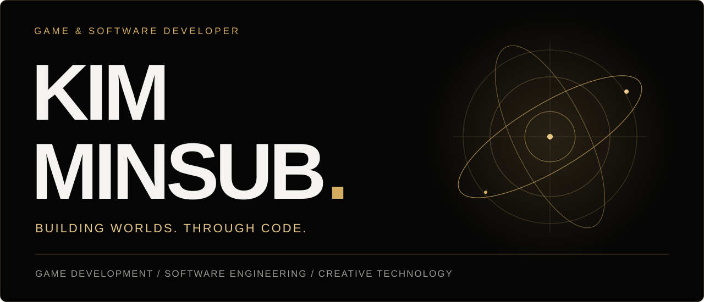
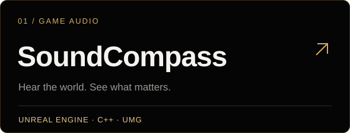
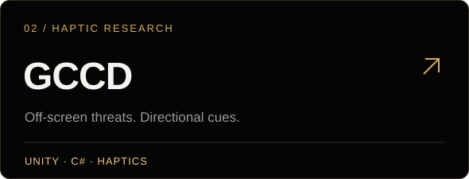
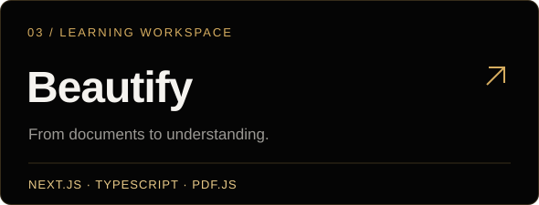
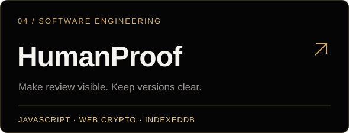

  

  

게임의 소리와 촉각, 그리고 사용자가 이해할 수 있는 인터페이스를 코드로 연결합니다.
Unreal Engine과 Unity의 실시간 경험부터 문서 기반 웹 워크스페이스까지, 작은 실험을 하나의 제품 흐름으로 발전시키고 있습니다.

### Selected work

<table>
<tr>
<td width="50%" valign="top">

게임에서 동시에 발생하는 소리를 중요도에 따라 선별하고, 파형과 방향 아이콘으로 표현합니다.

<a href="https://github.com/minsub1489/SoundCompass">소스 코드 ↗</a> · <a href="https://minsub-kim-portfolio.vercel.app/projects/soundcompass/">프로젝트 스토리 ↗</a>
</td>
<td width="50%" valign="top">

화면 밖 위협의 위치를 플레이어 기준 4방향으로 계산하는 Unity 연구 프로토타입입니다. 실제 장비의 진동 검증은 진행 중입니다.

<a href="https://github.com/minsub1489/GCCD">소스 코드 ↗</a> · <a href="https://minsub-kim-portfolio.vercel.app/projects/gccd/">프로젝트 스토리 ↗</a>
</td>
</tr>
<tr>
<td width="50%" valign="top">

PDF 열람·편집과 페이지 범위에 기반한 필기·퀴즈 생성을 연결하는 학습 워크스페이스입니다.

<a href="https://github.com/minsub1489/beautify.ai">소스 코드 ↗</a> · <a href="https://minsub-kim-portfolio.vercel.app/projects/beautify/">프로젝트 스토리 ↗</a>
</td>
<td width="50%" valign="top">

AI 작업의 인간 검토·승인 기록을 특정 PDF 버전에 연결하는 소프트웨어공학 팀 프로토타입입니다.

<a href="https://github.com/minsub1489/Software-Engineering">소스 코드 ↗</a> · <a href="https://minsub-kim-portfolio.vercel.app/projects/humanproof/">프로젝트 스토리 ↗</a>
</td>
</tr>
</table>

### Tools & interests

| 분야 | 사용하는 도구와 기술 |
| :--- | :--- |
| Game development | Unreal Engine · C++ · Blueprint · UMG / Unity · C# |
| Software & web | TypeScript · React · Next.js · JavaScript · Web Crypto · IndexedDB |
| Audio & interaction | 게임 오디오 시각화 · 방향성 햅틱 · Python · Pygame |
| Native exploration | SwiftUI · FoundationModels · 음성 인터페이스 |

### More stories

- [ArcticFox](https://minsub-kim-portfolio.vercel.app/projects/arcticfox/) — 팀의 3인칭 게임에 Main·Menu UI와 Widget Blueprint를 연결한 게임엔진기초 프로젝트.
- [KHU하기](https://minsub-kim-portfolio.vercel.app/projects/khu-quest/) — 캠퍼스의 작은 부탁을 퀘스트로 표현한 디자인적사고 팀의 서비스 기획·UI 프로토타입.
- [NOVA](https://minsub-kim-portfolio.vercel.app/projects/nova/) — SwiftUI·FoundationModels·음성 인터페이스를 연결하는 macOS 개인 비서의 기술 소개.

### Learning archive

[Spatial Audio](https://github.com/minsub1489/-GPI-Project-3) · [Hello, World.](https://github.com/minsub1489/Hello-World) · [자료구조 학습 공간](https://github.com/minsub1489/jaryoguzo) · [Colab 노트북 포크](https://github.com/minsub1489/school)

---

<a href="https://minsub-kim-portfolio.vercel.app/">전체 포트폴리오 보기 ↗</a> · <a href="https://github.com/minsub1489?tab=repositories">모든 저장소 ↗</a>

